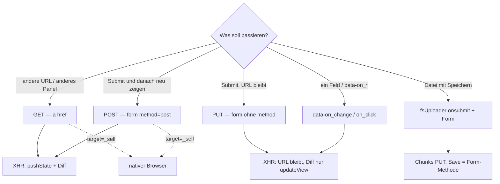

# Formulare & Dateneingabe

Wie Daten vom DOM zum Server kommen. DOM-Walk: [event-pathitem.md](./event-pathitem.md). Transport: [server-client-communication.md](./server-client-communication.md).  
Dateien in Forms: [fs-uploader.md](./fs-uploader.md#form-integration). Actions: [panel-actions.md](./panel-actions.md).

Umbau ist umgesetzt: Ajax-Default für Forms, PUT ohne `method`. Plan: [form-ajax-put-default.plan.md](../plans/form-ajax-put-default.plan.md).

---

## Ist (Code)

| Thema | Tatsächlich |
|---|---|
| **GET AJAX Diff** | **Panels** (`app.php`): immer. **Pages** (`site.php` + `renderPagesDiff.php`): nur GET, andere Pipeline — [pages-ajax-diff-migration.plan.md](../plans/pages-ajax-diff-migration.plan.md). |
| **POST AJAX Diff** | **Panels:** wie GET (`GET \|\| POST \|\| getUpdateViewsCount()`). Client `pushState`. Pages: kein Diff (unmigriert). |
| **PUT AJAX Diff** | nur bei `updateView()`. Kein URL-Wechsel. |
| **Links XHR** | Jedes `a` ohne `target` und ohne `download`. Opt-out: `target` (auch `_self`). |
| **Forms XHR** | analog zu Links: jedes `form` ohne `target` → `submit` → `processEvent`. Opt-out: `target="_self"`. `form.ajax` / `form[method=put]` sind keine Extra-Selektoren mehr. |
| **Form ohne `method`** | PUT; Felder in `event.data.form` → `http::form()`. |
| **`method="put"`** | kein HTML. Alias für fehlendes `method` (gleiche PUT-Pipeline). |
| **Einzel-Feld** | `[data-on_*]` reicht (Ancestors via `pathItem`). `class="ajax"` an Input/Select ist zusätzlicher Legacy-Selektor, nicht nötig für `data-on_*`. |

---

## Soll

GET und POST ändern die URL und **diff-rendern** (wie HTML `href` / `form action`).  
PUT ändert die URL nicht; Diff nur bei `updateView()`.

XHR ist Default (wie bei `a`). Kein XHR: `target="_self"` (oder anderes `target` / `download` bei Links).

Form **ohne** `method` → **PUT**. `method="put"` bleibt Alias (Kompatibilität, nicht HTML). Neu: Attribut weglassen.



---

## 2. Entscheidungsbaum (Soll)

| Ich will … | Markup | HTTP | PHP |
|---|---|---|---|
| Anderes Panel | `<a href="…">` | GET | `http::get()` |
| Speichern + URL/Render | `<form method="post" action="saveContact">` | POST | `http::post()` |
| Speichern, URL bleibt | `<form action="saveContact">` (kein method) | PUT | `http::form()` |
| Kein XHR (Login-Fullpage, Download) | `target="_self"` am `a` oder `form` | nativ | `$_GET` / `$_POST` |
| Ein Feld sofort | `data-on_change="…"`, `data-on_click="…"` | PUT | `http::values()` / `http::put()` / Dataset |
| Tippen mit Pause | `data-on_input="action"` (optional `.autosend`) | PUT | wie Feld |
| Change → ganzes Form | `.onchangesubmit` in der Form | Form-Methode | wie Form |
| Inline-Text | `domEditable` | PUT `sendCall` | `http::put('value')` |
| Datei mit Speichern | `data-upload="onsubmit"` in der Form | Chunks PUT, Save = Form | `fsUploader::postedFile()` |
| Datei sofort | fsUploader `instant` / `sendData` | PUT | `storeSpan` / `onFinish` |
| JS ohne Event | `sendCall(data, 'action')` | PUT | `http::put()` |

Relativ am offenen Panel senden. Nicht GET/POST zu einem anderen Pfad (`cms/storeSpan`).

---

## 3. Forms (Soll = wie `a`)

Bindung: jedes `form` ohne `target` → `submit` → `processEvent`. Opt-out: `target="_self"`.

```html
<form method="post" action="saveContact">
  <input name="contact_last_name">
  <button type="submit">Speichern</button>
</form>
```

- `method="get"` → Query, GET, URL + Diff
- `method="post"` → Body `post` (+ files), POST, URL + Diff
- kein `method` / `method="put"` → `form`-Felder, PUT, URL bleibt
- `action` → Trigger `on_submit`

`class="ajax"` an der Form wird überflüssig (wie `a.ajax`). Mehrere Submit-Buttons: `button[name=action]` setzt `form.action`.

---

## 4. PUT (kein `method`, URL bleibt)

```html
<form action="createAbsence">
  <input name="contact_absence_reason">
  <button type="submit">Anlegen</button>
</form>
```

PHP: `http::form('contact_absence_reason')`. Diff nur wenn die Action `updateView()` ruft.

`method="put"`: derselbe Pfad, nur noch Kompatibilität.

---

## 5. Einzelne Elemente

`data-on_change`, `data-on_click`, `data-on_input`, … — Werte und Dataset der Ancestors (`pathItem`), typisch PUT.

`class="ajax"` an Checkbox/Select/Button ist Legacy, wenn schon `data-on_*` da ist. In einem `method="post"`-Form laufen Feld-Events über POST (URL-Wechsel) — Felder, die PUT bleiben sollen, nicht in so ein Form packen.

---

## 6. Tippen, Enter, verzögert

| Verhalten | Bindung |
|---|---|
| Pause ~333 ms | `data-on_input="action"` (`.autosend` zusätzlich) |
| Change → Form-Submit | `.onchangesubmit` |
| contenteditable-Editor | `initHTMLeditorInputTimer` (~500 ms) |

Ohne `data-on_*` bricht `dispatch` ab. Enter im Input submitted die Form; in `domEditable` nur das Feld.

---

## 7. `domEditable`

Kein Form. PUT `sendCall`. Siehe bisher: `lib/class/dom/editable/`, PWK Brand `panel.js`.

---

## 8. Dateien

Siehe [fs-uploader.md — Form-Integration](./fs-uploader.md#form-integration). Kurz: Chunks immer PUT `storeSpan` am offenen Panel; danach Submit der Form (PUT oder POST).

---

## 9. JS / PHP

```javascript
sys.core.server.sendCall(data, 'saveField');   // PUT
sys.core.server.sendEventCall(event);
sys.core.server.sendGet('library/edit/brand/'); // GET + Diff
```

| Client | PHP |
|---|---|
| GET query | `http::get()` |
| POST body | `http::post()` |
| PUT form | `http::form()` / `http::posted()` |
| POST oder PUT form | `http::posted()` (form ?? post) |
| PUT values | `http::values()` |
| PUT dataset | `http::dataset()` |
| PUT JSON | `http::put()` |
| Staging-Datei | `fsUploader::postedFile()` |
| PUT-Binär | `http::binary()` |
