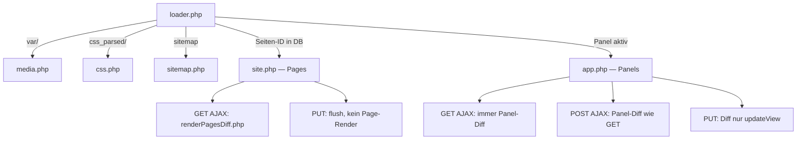

# Server ↔ Client Kommunikation

GET und POST verändern die URL (wie HTML `href` / `form action`). PUT nicht.  
Formulare: [form-data.md](./form-data.md). **Panel-Diff:** [panel-diff-rendering.md](./panel-diff-rendering.md) (`app.php`). **Pages-Diff** (`site.php`, Website, unmigriert): [pages-ajax-diff-migration.plan.md](../plans/pages-ajax-diff-migration.plan.md).

## Routing

| Bedingung | Handler |
|---|---|
| URL beginnt mit `var/` | `media.php` |
| URL beginnt mit `css_parsed/` | `css.php` |
| URL ist `sitemap` | `sitemap.php` |
| Seiten-ID in DB | `site.php` |
| Panel aktiv | `app.php` |

## Methoden

| | GET (kein AJAX) | GET (AJAX) | POST (AJAX) | PUT (AJAX) |
|---|---|---|---|---|
| Nutzlast | URL-Query | URL-Query | `$_POST` / `$_FILES` | JSON (+ opt. Binär) |
| PHP | `$_GET` | `$_GET` | `http::post()` | `http::put()` / `form()` / `dataset()` |
| Response | HTML | JSON Commands | JSON Commands | JSON Commands |
| URL | voll | `history.pushState` | `history.pushState` | nein (Referrer) |
| Diff-Render **Panels** (`app.php`) | nein | ja | ja (wie GET) | nur `updateView()` |
| Diff-Render **Pages** (`site.php`) | nein | `renderPagesDiff.php` | kein Diff (Legacy) | kein Render, nur Commands |

XHR-Default für Links und Forms gilt für **Panels**. Pages nicht in denselben Topf — [pages-ajax-diff-migration.plan.md](../plans/pages-ajax-diff-migration.plan.md). Forms: [form-data.md](./form-data.md).

### GET ohne AJAX

`app.php` / `site.php` rendern das Dokument. Renderer: `slices` (Standard, Layer-Tree + Session-Referenz), `markers`, `html` (Legacy).

### GET AJAX

`X-Requested-With: XMLHttpRequest`. Diff gegen Session-Referenz. Commands u. a. `updateDocument`, `updateClientData`, `loadJS`, `done`. Danach `history.pushState`.

### POST AJAX

`form method="post"` (ohne `target`): urlencoded oder `multipart` (Dateien). Wie HTML-Submit inkl. URL-Wechsel und Panel-Diff. PHP: `http::post()`. Opt-out: `target="_self"` (nativer Submit).

### PUT AJAX

Kein HTML-Pendant. Form **ohne** `method` (oder Alias `method="put"`): JSON in `call.data` (`dataset`, `form`, `values`, …). URL bleibt. `site.php` flusht oft ohne Diff; `app.php` rendert nur bei `getUpdateViewsCount() > 0`. PHP: `http::form()` / `http::posted()`.

Binär (Chunks): Stream `/*json:<länge>*/` + JSON + Bytes. PHP: `http::readPut()` / `http::binary()`.

Action an ein **anderes** Panel ohne Rendern: relative Action + **PUT**, nicht GET/POST-Pfad (`cms/storeSpan`).
